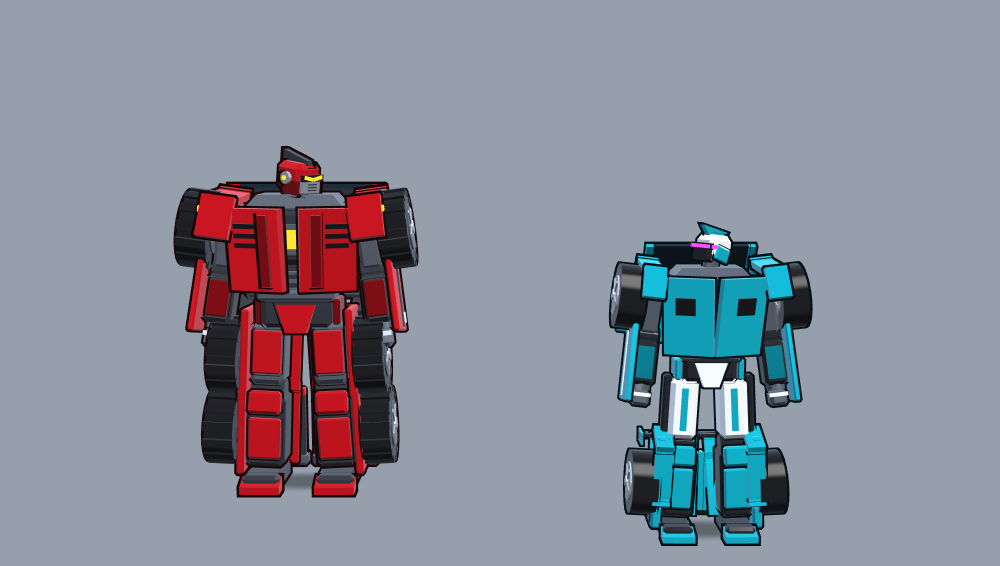
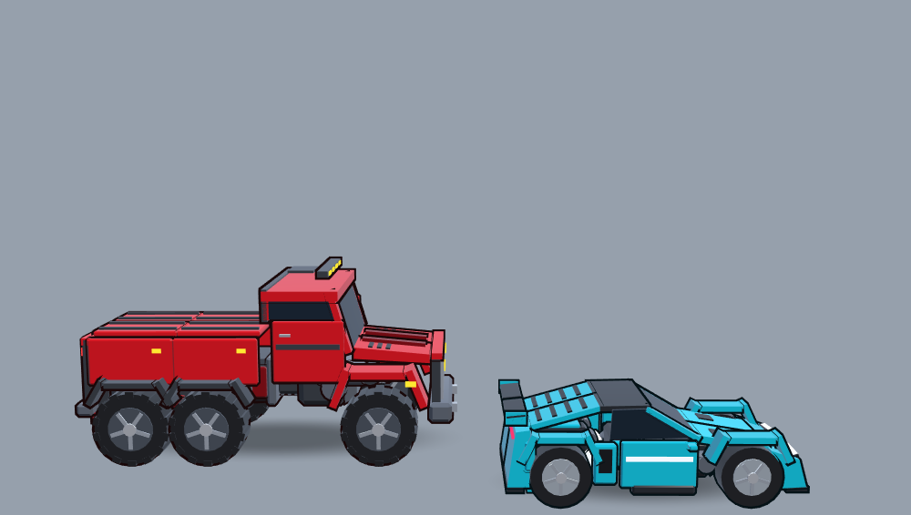
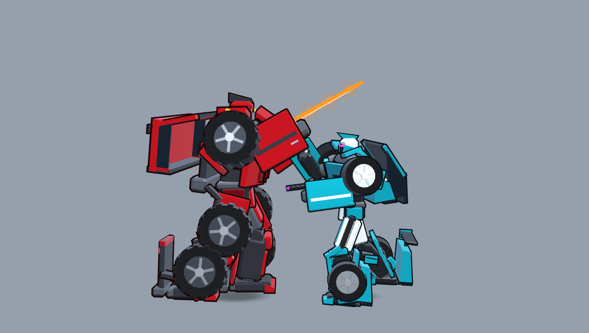
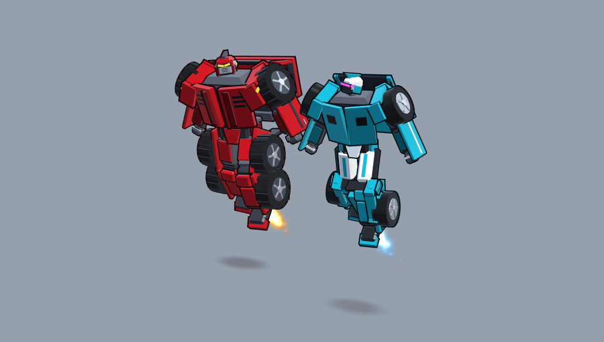
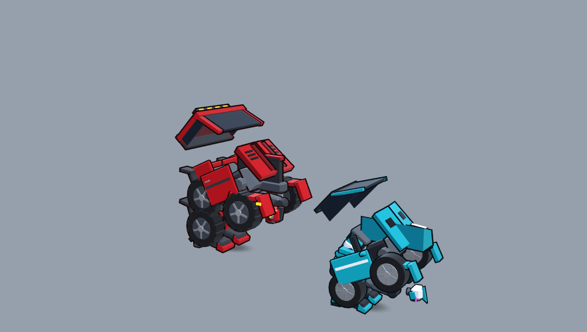

# RoboPets

Two original 3D transforming robots that live on your Windows desktop. They stand on the taskbar, follow your mouse with their eyes, wander around, fight, fly, and transform into vehicles.

| | |
|---|---|
|  |  |
|  |  |



## Meet the robots

- **Bulwark**, a crimson-and-graphite heavy robot. It transforms into a 6-wheel armored truck and fights with an orange plasma blade.
- **Volt**, a teal-and-white scout robot. It transforms into a low sports car and fights with a wrist blaster.

Both are original designs.

## Controls

Use these on the robots:

| Action | What happens |
|---|---|
| Hold right mouse button | They square off and fight: blade swings, blaster volleys, kicks, clashes, sparks and screen shake |
| Quick right click | They take off with jet thrusters; click again to land |
| Double-click a robot | It transforms between robot and vehicle (`T` transforms both) |
| Drag left / right | They walk with you along the taskbar |
| Drag up, then let go | They jump, then fall back down with gravity |
| Click a robot | It waves, flexes, salutes or nods |
| Mouse wheel | Spin the camera around them (Shift = tilt, Ctrl = zoom) |
| Keys `1`–`7` | Front, 3/4, back, left, right, top and bottom views |
| Middle click or tray icon | Menu: views, size, sound, wander on/off, start with Windows, hide, quit |

## How it works

- **Rendering:** OpenGL 3.3 through [moderngl](https://github.com/moderngl/moderngl). Each frame is drawn offscreen with 8x MSAA, a toon-style shader with ink outlines, and GPU particles for flames, sparks and blaster bolts.
- **See-through window:** the frame is read back as premultiplied BGRA and handed to a Win32 per-pixel-alpha layered window (`UpdateLayeredWindow`). Only the robots are visible, and clicks pass straight through everywhere else.
- **One body, two forms:** every part of each robot is a node with a robot pose (on the skeleton) and a vehicle pose. Transforming blends each part between the two with a staggered, arcing path, so the vehicle is built from the robot's own parts. Bulwark's chest plates become the hood, his shoulder wheels become the front wheels, his forearm shields become the doors, and so on.
- **Animation:** procedural walk, idle, flight and fight choreography with smoothed joint targets and foot-grounding.
- **No dependencies beyond the basics:** the window, tray icon, menus and sound are plain `ctypes` Win32 calls. Sound effects are synthesized with numpy on first run.

It draws a frame in about 5 ms and runs at 20–30 fps, so it is light enough to leave running all day. It also hides itself while a full-screen app or game is running.

## Run it

Windows 10/11, Python 3.10+ and a GPU with OpenGL 3.3.

```powershell
pip install -r requirements.txt
pythonw robopets.pyw
```

Use the tray menu to make it start with Windows.

`shot.py` renders test pictures offscreen, which is handy for tweaking the designs:

```powershell
python shot.py out.png fight hero 3
```

## Files

| File | What it does |
|---|---|
| `robopets.pyw` | The app: Win32 layered window, input, tray icon, menu, sound, autostart |
| `sim.py` | Animation, behaviours, fight and flight choreography, camera, particles |
| `bots.py` | The two robot designs and how each part maps from robot to vehicle |
| `engine3d.py` | Mesh primitives, shaders and the offscreen renderer |
| `shot.py` | Offscreen screenshot tool |
| `3D_PROMPTS.txt` | Prompts for AI 3D generators to make higher-detail models of Bulwark and Volt |
